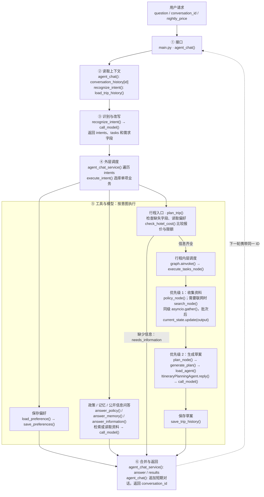

# 差旅 Agent：一张总图看懂当前项目

核对日期：2026-11-06。依据当前练习代码和本地居丽叶差旅项目源码整理，不以课程 README 的功能描述代替代码事实。本次只整理说明，不更换框架、不拆目录。

先记一句话：接口收问题，记忆提供上下文，模型列出待办事项，Python 调用对应业务，最后收集结果并返回。

## 1. 一张总图

图中展示的是统一入口 `POST /api/agent/chat` 的数据流。节点不代表独立进程，也不代表各使用一个不同模型。



图里的“优先级 1 / 2”是当前提示词规定的典型规划计划，执行器实际读取模型生成的 `tasks`。它不是把两个优先级硬编码进 Python。

## 2. 用已经跑通的请求读图

请求：

```json
{
  "question": "记住，以后只住汉庭。请安排我2026年11月10日从深圳去上海出差三天，不用联网。",
  "nightly_price": 450
}
```

1. `agent_chat()` 接收问题、报价和可选会话 ID。新会话创建 ID，已有会话取出最近对话。
2. `recognize_intent()` 把本次问题、短期对话、最近行程和 Skill 简介交给模型，识别出保存偏好与规划行程两个意图。
3. `agent_chat_service()` 依次调用 `execute_intent()`：先保存汉庭，再进入 `plan_trip()`。
4. `plan_trip()` 检查出发地、目的地、日期、天数，处理酒店偏好；`check_hotel_cost()` 读取限额，得出 450 > 400，需要审批。
5. 规划工作流先执行 `policy_node()`，再执行 `plan_node()`；不用联网时没有 `search_node()`。前一批结果写入 `current_state`，后一批才能使用。
6. 规划 Agent 调用模型生成草案；`save_trip_history()` 将草案写入文件。
7. 外层收集两项结果，返回合并的 `answer` 和分项 `results`。接口再保存本轮问答并附上 `conversation_id`。

这组请求已由实际返回结果确认：偏好保存、行程生成、结构化费用判断均返回成功。返回正文不能单独证明并行时序；执行顺序看终端日志或源码。

## 3. 只需分清这些名字

| 名字 | 含义 | 当前例子 |
|---|---|---|
| `intents` | 用户这次要办哪些事 | 保存偏好、规划行程 |
| `tasks` | 行程规划内部做哪些步骤 | 检索政策，然后生成草案 |
| `requirements` | 提取和补全后的需求字典 | 深圳、上海、日期、三天，以及任务清单 |
| `TravelState` / `state` | 一次规划运行中的数据 | 需求、搜索资料、政策资料、草案 |
| `results` | 已执行业务的分项返回值 | 偏好确认、行程结果 |

外层 `intents` 当前顺序执行，遇到非 `completed` 状态就停止；内层 `tasks` 同优先级使用 `asyncio.gather()` 并行，批次之间顺序执行。两层处理不同粒度的任务。

## 4. 函数与文件索引

| 职责 | 当前真实位置 |
|---|---|
| HTTP 请求、会话保存、最终响应 | [main.py](main.py) 的 `agent_chat()` |
| 识别、改写、生成意图和任务列表 | [intent_practice.py](intent_practice.py) 的 `recognize_intent()` |
| 遍历意图、收集和合并结果 | 同文件的 `agent_chat_service()` |
| 分派一项业务 | 同文件的 `execute_intent()` |
| 检查规划字段并启动图 | 同文件的 `plan_trip()` |
| 分优先级执行规划任务 | 同文件的 `execute_tasks_node()` |
| 政策知识库构建和检索 | [policy_service.py](policy_service.py) 的 `PolicyService.load()` / `search()` |
| 网络搜索 | [search_service.py](search_service.py) 的 `search_information()` |
| 报价与城市限额比较 | [compliance_service.py](compliance_service.py) 的 `check_hotel_cost()` |
| 读写长期偏好 | `intent_practice.py` 的 `load_preference()` / `save_preferences()` |
| 读写历史草案 | [memory_service.py](memory_service.py) 的 `load_trip_history()` / `save_trip_history()` |
| Skill 简介、详细指令和规划 Agent 加载 | [skill_loader.py](skill_loader.py) 的 `load_skill_metadata()` / `load_skill()` / `load_agent()` |
| 规划 Agent 的实际处理 | [agent.py](skills/plan-trip/script/agent.py) 的 `ItineraryPlanningAgent.reply()` |
| 统一调用聊天模型 | [llm_service.py](llm_service.py) 的 `call_model()` |

`call_model()` 使用本地 `qwen3.5:9b`。一个请求可能多次调用同一个模型，函数或角色增加并不意味着更换了多个模型。政策向量化另用 `qwen3-embedding:4b`，它负责把文字转换成向量，不负责生成聊天回答。

本图专门说明统一 API。`/api/policy/chat` 与 `/api/trip/plan` 是直接业务入口，不经过上述完整多意图分派和会话保存流程。终端 `main()` 仍保留较早的单意图练习流程，不能当作统一 API 的等价入口。

## 5. 五种“保存数据”不要混淆

| 数据 | 放在哪里 | 用途与寿命 |
|---|---|---|
| 短期对话 | `main.py` 的 `conversation_history` 字典 | 按 ID 保存最近20条消息；重启或自动重载后清空 |
| 待补全信息 | `pending_trips` 字典 | 缺信息时保留报价等内容；任务结束后删除对应记录 |
| 长期偏好和历史草案 | `preferences.json`、`trip_history.json` | 跨重启保留；当前是单用户文件，草案不代表实际出行 |
| 一次规划的数据 | `TravelState` | 让节点共享当前运行的需求和中间结果；不是长期存储 |
| 已创建的规划 Agent | `skill_loader.py` 的 `agent_cache` | 复用 Python 实例；不是缓存回答，每次 `reply()` 仍调用模型 |

## 6. 对照课程：完成在哪里，简化在哪里

课程参考目录：`D:\project-ai\居丽叶\居丽叶简历项目6：差旅出行助手\居丽叶简历项目6：差旅出行助手`。下表中的“简化”表示学到了对应流程，但没有逐行复刻课程结构。

| 课程内容 | 当前状态 | 对照结论 |
|---|---|---|
| 意图识别与 Query 改写 | 已实现核心流程 | 对应课程 `IntentionAgent.reply()`；用已有对话和最近草案补全问题 |
| 多意图识别与结果聚合 | 已实现已演示的组合 | 已跑通“偏好 + 政策”和“偏好 + 规划”；当前共用顶层需求字段，不等同于任意多套独立行程的完整实体分配 |
| 事项收集和缺失信息追问 | 简化实现 | 放在 `recognize_intent()` 与 `plan_trip()`；未拆成课程的 `EventCollectionAgent`，也没有覆盖它的全部字段 |
| 优先级与并行调度 | 简化实现 | 规划内部按优先级执行；外层多个意图仍顺序执行。课程 `OrchestrationAgent` 在 Agent 调度层分优先级并行 |
| 短期对话记忆 | 简化实现 | 内存字典保留约10轮；课程封装为 `ShortTermMemory`，同样有滑动窗口 |
| 长期偏好、行程保存与查询 | 简化实现 | 当前是单用户 JSON；课程 `LongTermMemory` 还包含用户区分、长期聊天记录和统计等 |
| 偏好追加和替换 | 已接入 API | 模型输出动作，Python 更新文件；当前重复追加会产生重复品牌，规划分支仍可能重新覆盖偏好值 |
| RAG 政策问答 | 简化实现 | 当前 FAISS + Ollama Embeddings；课程 `RAGKnowledgeAgent` 使用 Milvus Lite + sentence-transformers，并包含更多知识管理方法 |
| 独立公开信息查询 | 简化实现 | 当前 Bing RSS 搜索后生成回答；课程 `InformationQueryAgent` 使用 DDGS，并有独立天气查询路径 |
| Skill 简介发现与详细指令读取 | 已实现核心流程 | 对应课程 `SkillLoader` 的元数据读取和执行阶段读取正文 |
| Agent 代码懒加载 | 部分实现 | 只有规划 Agent；显式提供技能名和类名，并复用实例 |
| 完整插件注册与自动类发现 | 尚未实现 | 未复刻 `LazyAgentRegistry` 的执行脚本扫描、名称映射、`AgentBase` 子类识别、构造参数注入等 |
| AgentScope 的 Agent / 消息机制 | 尚未采用 | 当前是 FastAPI + Python 函数 + LangGraph；课程使用 `AgentBase`、`Msg` 和各 Agent 的 `reply()` |
| 长期聊天保存与模型摘要 | 尚未实现 | 当前仅持久化偏好和行程；课程有 `add_chat_message()` 与 `get_long_term_summary_async()` 等方法 |
| 专用天气查询、更多偏好类型 | 尚未实现 | 尚未移植原版天气接口，以及航空公司、座位等更完整的偏好能力 |

课程源码中的存储事实：`ShortTermMemory.messages` 是 Python 列表，`LongTermMemory` 将数据写入 `data/memory/<user_id>.json`。这份源码不能因为 README 提到 Redis/PostgreSQL，就认定已接入这些数据库；本阶段无需为了追齐宣传描述而补数据库。

我们的 FastAPI 接口、独立的确定性住宿金额检查，以及 `tool_practice.py` 中的 Ollama 工具调用闭环，是练习中的接口或扩展内容，不应当成原课程多 Agent 架构的完整复现。统一业务流程也不是完全通过原生 `tool_calls` 驱动。

可对照的课程文件：

- `agents/intention_agent.py`：识别、上下文改写、输出调度计划。
- `agents/orchestration_agent.py`：按优先级分批执行、传递前序结果、聚合输出和更新记忆。
- `agents/lazy_agent_registry.py`：发现执行脚本、加载模块、找到 Agent 类、创建并缓存实例。
- `context/short_term_memory.py`、`context/long_term_memory.py`、`context/memory_manager.py`：短期记忆、持久化记录及摘要。
- `.claude/skills/`：规划、事项收集、偏好、查询、记忆等 Agent 及指令。

本次仅检查源码和已展示的运行结果，没有启动原版课程系统，因此不据此承诺原版所有路径都能在当前环境运行。

## 7. 现在是否继续学完整 AgentScope 插件机制

建议：暂时不把练习项目重构成原版。先用上面的总图讲清一次请求，再单独读原版三处对应关系，不同时修改业务和架构。

| 目前已经理解的职责 | 原版对应 |
|---|---|
| `recognize_intent()` | `IntentionAgent.reply()` |
| 外层 `agent_chat_service()` + `execute_intent()`，以及规划内层执行器 | `OrchestrationAgent.reply()` 及执行方法；职责可对照，调度粒度不完全相同 |
| `load_agent()` | `LazyAgentRegistry.__getitem__()` |

下一节若继续，先读懂 `AgentBase`、`Msg`、`reply()` 如何承载这些已有职责；暂时不装新数据库、不把所有函数拆成插件、不增加防御性编程。

什么时候值得完整学习和实现：需要真正动态加入新的 Agent、复用原版 AgentScope 项目，或明确要掌握 AgentScope 框架时。仅为理解 Agent 的识别、调用、记忆和执行流程，当前实现已经提供了可运行的学习基础。

最后的边界：流程跑通不等于正文全部可靠。已观察到模型忽略450元报价、自行补时间、标错政策来源等问题。结构化 `hotel_cost_check` 是独立的金额比较结果；不要把生成草案当作真实预订或审批结果。
